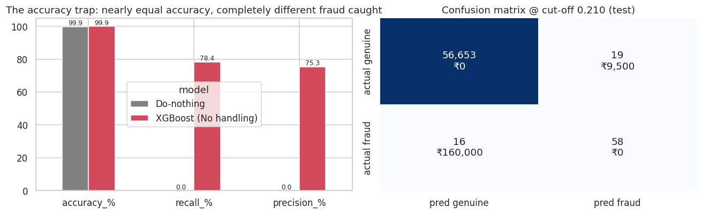
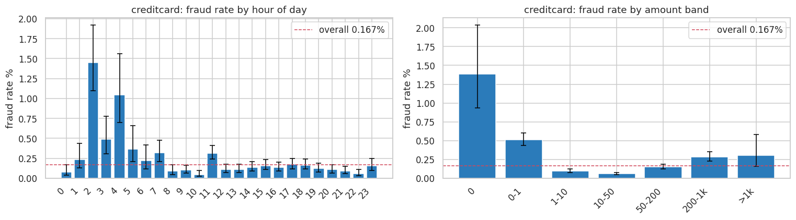
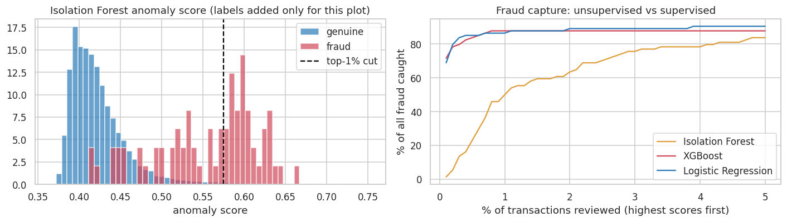
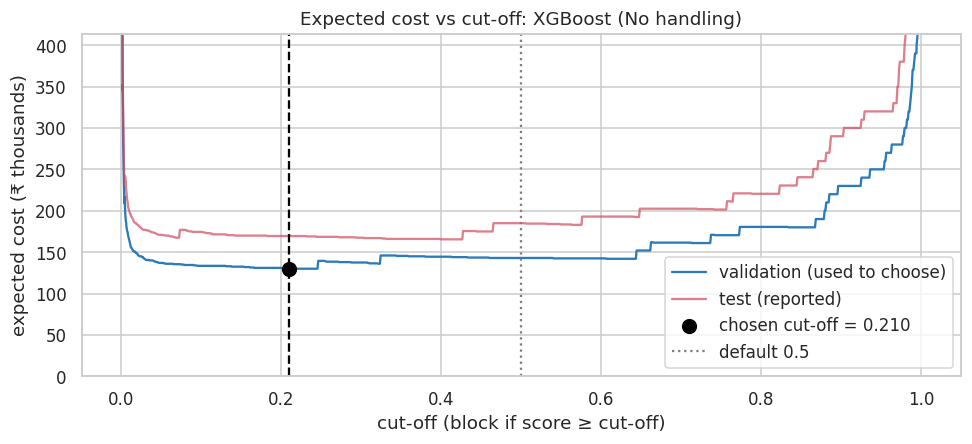
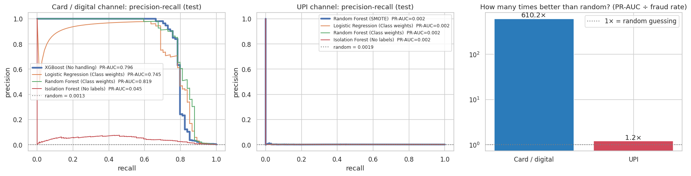
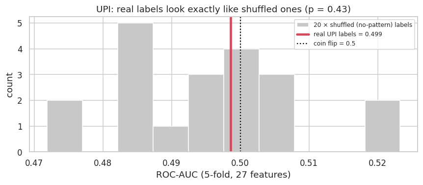

# Catch Fraud, Not Customers

### A cost-aware fraud decision system for UPI and digital payments

**KLU+Path-3 · ML-02 Hackathon · Business report**
Team: [names] · Code: `github.com/MohammedMutee/upi-fraud-detection`

> **How to read the numbers.** Every result is measured on a held-out test slice that was used once, after all choices had been made on a separate validation slice. The rupee costs (₹10,000 per missed fraud, ₹500 per wrongly blocked customer, ₹10 per OTP) are **placeholder assumptions**, because no official values were published. Every saving is therefore a **scenario estimate**, kept apart from the observed results.

---

## Executive summary

Fraud is rare: about **1 in 600** payments. That makes "accuracy" useless. A model that approves everything is **99.87% accurate and catches no fraud at all**.

We built a decision system that scores each payment and gives one of three outcomes: **approve**, **ask for an OTP**, or **block**. The cut-offs are chosen by rupee cost, not by habit. We then ran the identical pipeline on two payment channels.

| | Card / digital channel | UPI channel |
|---|---|---|
| Final model | XGBoost | Random Forest (SMOTE) |
| How much better than random (PR-AUC ÷ fraud rate) | **610×** | **1.2×** |
| Fraud caught at the chosen cut-off | **78%** (58 of 74) | 0% |
| Genuine customers blocked | 19 of 56,672 | 2 of 49,904 |
| Expected cost vs doing nothing | **81% lower** (scenario) | 1.9% lower (noise) |

On the card channel the system catches most fraud while troubling very few customers. On the UPI channel the labels carry **no learnable pattern**. The real UPI labels score no better than labels we shuffled at random (p = 0.43), and the system correctly refuses to block anyone on a signal it doesn't have.

**Three recommendations:**
1. Pilot the 3-zone rule on card traffic.
2. Add a label-free anomaly detector as a review queue for new scams.
3. Fix how UPI fraud is labelled before investing in UPI models.

---

## 1. The business problem

A payment app loses money two ways. **Missing a fraud** loses the money and the customer's trust. **Blocking a genuine customer** (at a shop counter, or paying rent) loses goodwill, and the customer may switch apps. Between the two sits a cheap middle step: a **step-up OTP**, which takes a real customer five seconds but stops most account takeovers.

The task is a scoring system that catches as much fraud as possible without troubling genuine users, together with evidence for where its thresholds sit.

## 2. Data and data quality (PS1)

| Channel | File | Payments | Frauds | Nature |
|---|---|---|---|---|
| UPI | `upi_transactions 2024.csv` | 250,000 | 480 (0.19%) | Simulated, as the brief states. Readable fields: type, merchant, bank, device, amount in ₹ |
| Card / digital | `creditcard.csv` (ULB) | 284,807 | 492 (0.17%) | Real card payments over 2 days; features anonymised by PCA |

**What we found and did:**

| Check | Finding | Treatment |
|---|---|---|
| Duplicate rows (card) | 1,081, of which 19 are fraud | **Removed.** A copy in both train and test inflates scores. 283,726 rows remain |
| Amount = 0 (card) | 1,825 | Kept: likely card-verification pings |
| Missing values, bad timestamps | None in either file | No action |
| UPI quality overall | Zero problems of any kind | Noted: unusually perfect, the first hint the data is synthetic |
| `transaction_status` (UPI) | 12,376 FAILED | **Excluded as leakage**: only known after processing |
| `transaction id` (UPI) | Unique per row | Excluded: an identifier, not a signal |

**Split:** time-aware. The oldest 60% is for training, the next 20% for validation (every choice is made here), and the newest 20% for testing (reported once). This mirrors real life, where yesterday's data predicts tomorrow's fraud.

## 3. The accuracy trap and the metrics we use (PS2)

A do-nothing model is **99.87% accurate** and has **0% recall**. Our final model is also about 99.9% accurate, but catches 78% of fraud. Accuracy can't tell them apart, so we use:

- **Recall:** the share of fraud stopped.
- **Precision:** the share of alarms that are real.
- **F1:** a balance of the two.
- **PR-AUC:** ranking quality across all cut-offs. This is our main model metric.
- **Expected ₹ cost:** the business decision metric.
- **ROC-AUC:** reported only with a warning, because it flatters rare-event models.

## 4. Where fraud lives (PS3)

**Card / digital channel:**
- **Night:** fraud is about **5× more common between 1 and 5 AM** (0.67% vs 0.14%), peaking at 1.45% at 2 AM.
- **Amount** is U-shaped: tiny "card-testing" payments (₹0–1: 0.51%) and large ones are riskier than mid-range payments (0.06%).

**UPI channel:** every transaction type, bank, state, device and hour sits on the overall rate. Thirteen chi-square tests found nothing that survives a correction for multiple testing.

*These are observed associations, not causes.*

## 5. Supervised models (PS4)

We trained Logistic Regression, Random Forest and XGBoost, each three ways: no imbalance handling, class weights, and SMOTE inside the training pipeline only. We also built a hand-written rule baseline. Each model's cut-off was chosen on validation.

| Model (card channel, test) | PR-AUC | Frauds caught | Genuine blocked | Expected cost |
|---|---|---|---|---|
| Rule: night + tiny amount | 0.002 | 28 / 74 | **6,343** | ₹36,31,500 |
| Logistic Regression (class weights) | 0.745 | 55 / 74 | 24 | ₹2,02,000 |
| Random Forest (class weights) | 0.819 | 56 / 74 | 9 | ₹1,84,500 |
| Random Forest (SMOTE) | 0.812 | 61 / 74 | 81 | ₹1,70,500 |
| **XGBoost (no extra handling): final** | **0.796** | **58 / 74** | **19** | **₹1,69,500** |
| XGBoost (class weights) | 0.791 | 56 / 74 | 10 | ₹1,85,000 |

**Findings:**
- **Hand-written rules fail.** The rule catches 38% of fraud but troubles 6,343 good customers, which costs about 5× more than doing nothing.
- **Imbalance handling helps simple models** (Logistic Regression's PR-AUC rose from 0.61 to 0.75 with class weights). For tree models, a cost-tuned cut-off does the same job.
- **Model selection** used a rule fixed in advance: the lowest validation cost, with ties broken by validation PR-AUC. XGBoost won, and it trains in about 3 seconds against about 45 for Random Forest. Random Forest scored slightly higher PR-AUC on *test*, but switching on test results would be tuning on the test set, so the validation choice stands.

## 6. Finding unknown fraud without labels (PS5)

New scam types have no labels yet. An **Isolation Forest** trained without any fraud labels put **50% of all test fraud in its top 1%** of unusual payments, and 84% in its top 5%. The supervised model reaches 88% in its top 1% with twice the precision, so the two are complementary.

The Isolation Forest also shows why ROC-AUC misleads on rare events: **ROC-AUC 0.95, but PR-AUC only 0.05.**

## 7. Choosing the cut-off by cost (PS6)

Expected cost = missed frauds × ₹X + wrongly blocked genuine payments × ₹Y. Sweeping about 1,500 cut-offs on validation gives a cost-minimising cut-off of **0.21**, not the habitual 0.5.

| Policy (card channel, test) | Expected cost | vs doing nothing |
|---|---|---|
| Do nothing | ₹7.40 lakh | n/a |
| Default 0.5 cut-off | ₹1.85 lakh | −75% |
| **Cost-chosen 0.21 cut-off** | **₹1.70 lakh** | **−77%** |

**Sensitivity:** across 15 cost scenarios, the best cut-off stays at 0.21 for every ratio of ₹X to ₹Y between 10 and 100. It rises to 0.61 when blocking is relatively expensive (ratio ≤ 5) and falls towards 0 when missed fraud dominates (ratio ≥ 200). The decision is robust to the exact cost values.

## 8. The decision rule: approve, step-up OTP, block (PS7)

Two cut-offs (T1 = 0.0005, T2 = 0.515) were chosen on validation, with the OTP zone capped at 5% of traffic so the rule could realistically ship.

| Zone (card, test) | Share of payments | Frauds | Genuine customers affected | Expected cost |
|---|---|---|---|---|
| ✅ Approve | 96.6% | 10 | none | ₹1,00,000 |
| 📱 Step-up OTP | 3.2% | 8 | 1,828 asked for an OTP | ₹34,360 |
| ⛔ Block | 0.11% | **56 (76% of all fraud)** | only 9 blocked | ₹4,500 |
| **Total** | 100% | 74 | | **₹1.39 lakh** |

The 3-zone rule is **81% cheaper than doing nothing** and 18% cheaper than the best single cut-off. To prove the saving comes from the model, not from cheap OTPs, we compared it with two policies that use no model. *OTP everyone* costs ₹7.15 lakh and *OTP a random 5%* costs ₹7.60 lakh.

## 9. Two channels, one pipeline, and the UPI finding

The identical pipeline, with no channel-specific tuning, is **610× better than random on cards** and only **1.2× on UPI**. To check whether better modelling or data cleaning could rescue the UPI channel, we:
1. added **14 engineered features** (round amounts, same bank, age gap, minute and second, amount relative to its category, transaction order);
2. used a strong gradient-boosting model with 5-fold cross-validation;
3. compared the **real labels with 20 randomly shuffled copies**.

The real UPI labels score **ROC-AUC 0.499**; shuffled labels score **0.495 ± 0.013** (p = 0.43). The fraud flags were assigned without regard to any recorded column. **Cleaning cannot fix this:** cleaning repairs broken values, and this file has none. Creating our own labels would be circular and would amount to fabricating results.

The system behaved correctly on this channel. Seeing no signal, the cost rule chose not to block (2 blocks in 50,000 payments) instead of troubling customers at random.

## 10. Three recommendations (PS8)

| # | Finding (observed) | Evidence | Action | Priority |
|---|---|---|---|---|
| 1 | A cost-tuned 3-zone rule loses the least money | ₹1.39 lakh vs ₹7.40 lakh doing nothing; blocks only 0.11% of payments | **Pilot XGBoost + Approve/OTP/Block** on a slice of live card traffic; re-tune the cut-offs monthly with real costs | High |
| 2 | Label-free detection finds half of all fraud in its top 1% | Isolation Forest: 50% in the top 1%, 84% in the top 5% | **Add the anomaly score as a second line of defence**: route unusual-but-approved payments to human review to catch new scams | Medium |
| 3 | UPI labels carry no learnable signal | 1.2× random; identical to shuffled labels (p = 0.43) | **Audit UPI fraud labelling** (label from confirmed complaints and chargebacks). Until then: approve + capped OTP on UPI, never auto-block | High |

**Why the model blocks:** SHAP shows the strongest drivers are the anonymised features V4, V14, V12, V10 and V11, followed by hour of day and amount. That is consistent with the night-time and card-testing patterns in Section 4.

## 11. Limitations

- **Costs are placeholders.** Savings are scenario estimates; the official values may move the cut-offs (Section 7 shows by how much).
- **The OTP stop rate (80%) and the 5% OTP cap are assumptions.**
- **The card data covers two days, and the test slice holds 74 frauds.** One fraud equals 1.4 points of recall, so the metrics carry sampling noise, and seasonal patterns can't be tested.
- **Card features V1–V28 are anonymised.** Drivers can be ranked but not named.
- **The UPI data is simulated** and its labels carry no signal. UPI results show how the system behaves on weak data; they don't describe UPI fraud patterns.
- **All relationships are observational associations**, not causes.

## Appendix: reproducibility

- **Notebook:** `notebooks/fraud_analysis.ipynb`. Seed 42, deterministic, about 15 minutes end to end. Generated from `scripts/build_notebook.py`.
- **Tables and charts:** `outputs/tables/`, `outputs/figures/`; key numbers in `outputs/summary.json`.
- **Demo:** `streamlit run app/streamlit_demo.py` scores a payment and returns Approve / OTP / Block.
- **To use official costs:** edit the four constants in the notebook's first code cell and re-run.
